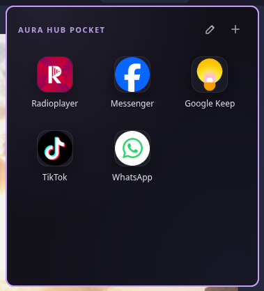
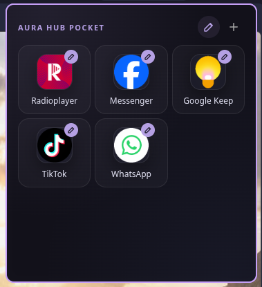
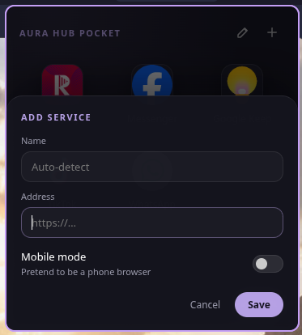

# Aura Hub Pocket

Floating mobile web apps — Messenger, TikTok, Google Keep, WhatsApp, anything — in small
phone-sized windows that run inside your own Chromium-based browser.

An Electron-free successor to [Aura Hub](https://github.com/UnderStackDev/aura_hub): instead of
shipping its own browser engine, Aura Hub Pocket is a browser extension. Every service window
is a real browser window in your profile, so your **logins, passwords, ad blocking and other
extensions just work** — services open already signed in.

| Launcher | Edit mode | Add a service |
|---|---|---|
|  |  |  |

## Features

- **Launcher** — a small window with your services, most recently used first (pinned ones on top).
- **One window per service** — no tabs, no address bar. Clicking a service that's already open
  brings its window back instead of opening a second one.
- **Mobile mode** (per service) — the site sees a phone browser (user agent, client hints and
  `navigator` values). It only affects Pocket windows: the same site in a normal tab stays desktop.
- **Add from the browser** — *Current tab → Add* in the launcher, or right-click any page or link →
  *Add page/link to Aura Hub Pocket*. Name and icon are detected automatically.
- **Unread badges** — counts like "(3) Messenger" in page titles show up on the tile and the
  toolbar icon.
- **Remembers window size** per service when you resize a window.
- **Floating on Hyprland** — with the included window rules, service windows float on top of
  everything, stay visible on every workspace and open at the right edge of the screen.

Default services: Messenger, TikTok, Google Keep, WhatsApp and Radioplayer. Edit or remove them
with ✎.

## Install

Tested in Brave and Chromium; other Chromium-based browsers (Chrome, Edge, Vivaldi) should work too.

1. Clone the repo somewhere permanent:
   ```bash
   git clone https://github.com/UnderStackDev/aura_hub_pocket.git ~/aura_hub_pocket
   ```
2. Open `brave://extensions` (or `chrome://extensions`) and turn on **Developer mode**.
3. **Load unpacked** → select the `extension` folder inside the repo.
4. Pin the Aura Hub Pocket icon to the toolbar, or press `Alt+Shift+P`.

Don't move the folder after loading it: an unpacked extension's ID comes from its path, and the
Hyprland rules below match that ID.

To update: `git pull`, then press the reload button on the extension's card in
`brave://extensions`. Your services and settings are kept.

## Floating windows on Hyprland (Omarchy)

Without these rules the windows still work, but Hyprland tiles them like any other window.

1. Copy the extension's **ID** from its card in `brave://extensions` (32 letters).
2. Install the rules with your ID:
   ```bash
   sed 's/EXTENSION_ID/<your-extension-id>/g' ~/aura_hub_pocket/hyprland/aura-hub-pocket.lua \
     > ~/.config/hypr/aura-hub-pocket.lua
   ```
3. Add this line to `~/.config/hypr/hyprland.lua`:
   ```lua
   require("hypr.aura-hub-pocket")
   ```
4. Run `hyprctl reload`.

The rules ([`hyprland/aura-hub-pocket.lua`](hyprland/aura-hub-pocket.lua)) are written for
Omarchy's Lua Hyprland config. On a classic `hyprland.conf`, set the same properties for windows
whose class matches `^.+-<your-extension-id>-.+$`: float, pin, no shortcuts inhibit and a move to
the right edge — plus `no_follow_mouse` for the launcher (title `Aura Hub Pocket Launcher`) so it
stays open until you click elsewhere.

## Usage tips

- **Launcher** closes when you click elsewhere, open a service or press `Esc`.
- **Mobile mode** — if a site shows a "get the app" wall in mobile mode, turn mobile mode off:
  in a narrow window most sites switch to their mobile layout anyway.
- **Window size** — set it in the service's edit panel, or just resize the window.

## How it works

- `extension/background.js` — service worker: service list (`chrome.storage.local`), open
  windows (`chrome.storage.session`), per-tab mobile-mode rules (`declarativeNetRequest`),
  icon detection and unread badges.
- `extension/mobile-ua.js` — runs at `document_start` in pages; only acts when the mobile-mode
  rule has marked the response, so normal browsing is untouched.
- `extension/launcher.*` — the launcher UI.

## License

[MIT](LICENSE) © UnderStackDev
